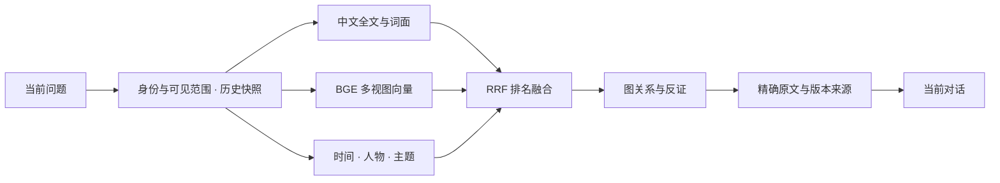

# WARMAGENT-Public

**有记忆，有主见，有行动，也有自己的生活节奏。**

**把长期相处，做进 Agent 的底层。**

昨天的经历有来源，今天的更正有版本，被打断的事情有断点。它能聊天、能亲手做事，也可以在空闲时探索兴趣、记下想法，或者安静地休息。你回来时，它把注意力交还给你；聊完之后，它还有自己的下一步。

WARMAGENT 把持久记忆、聊天、自主活动和本地工具接在同一个主脑上。微信、QQ、命令行与浏览器都是认识它的入口，连续的经历和实际行动构成它的日常。公开示例角色叫“小温暖”，你可以在本地赋予它自己的名字和性格。

[我们的理念](docs/理念与设计.md) · [技术亮点](#长期记忆做到能追问来历) · [为什么选择我们](docs/项目对比与优势.md) · [近期功能](docs/FEATURES_2026-10-29.md) · [快速开始](#快速开始) · [架构](docs/ARCHITECTURE.md) · [部署](docs/DEPLOYMENT.md)

## 为什么选择 WARMAGENT

**如果你想长期相处的是同一个能聊天、能行动、能续做的 Agent，WARMAGENT 的长处就在这里。**

我们把个人日常里的细节直接做进运行机制：连续未读会合在一起读；在群聊里可以按条查看本轮同群近期原文；你回来聊天时优先回应，安静后接着原来的事情；兴趣会留下进展，想说的话可以先记在本子里，也可以在本地生活小本页面查阅。任务完成、通知排队、消息送达，也各自有清楚的记录。

| 对比方向 | 我们为这个场景打磨的优势 |
| --- | --- |
| 角色对话与聊天前端 | 将角色表达接到实际行动、持久活动与环境回执上，陪聊和做事共用同一主脑 |
| 通用 IM 机器人平台 | 围绕个人长期相处，集成未读合并、群聊分寸、聊天优先、活动恢复和兴趣随笔 |
| 有状态 Agent 与记忆框架 | 将记忆来源、修正、渠道范围进一步接到日常消息处理和真实投递状态 |
| 专家协作与工作流平台 | 让一个持续相处的主脑直接做事，支持临时插话、续做、自选活动和休息 |
| 通用工具与记忆中间件 | 采用原生工具调用，围绕同一主脑组织执行回执、活动槽、后台事件和 outbox |

**我们的优势，在于把长期相处所需的整套体验做得连贯、细致、可追溯。** 具体选型对照涵盖 SillyTavern、AstrBot、Letta、AutoGPT 和 VCPToolBox，见[项目对比与优势](docs/项目对比与优势.md)。

## 我们相信，好的 Agent 应该怎样生活

**记忆要有来处。** 记得谁说过什么、当时在什么场景、后来有没有修正。让共同经历逐渐积累，让误会有机会澄清，让今天的对话接得上昨天。

**行动要有下文。** 同一个主脑理解需求、调用工具、读取结果，再向你汇报。任务可以分步推进，长工作可以交给后台；完成、失败和结果未知，都有各自准确的位置。

**自主包括休息。** 探索、娱乐、创作、改变方向和暂时放下，都是合理的选择。兴趣有进展，想法有地方保存；每次醒来，也可以决定先歇一会儿。

**亲近容得下主见。** 它可以表达不同看法，识别玩笑，也可以在群聊里选择不插话。认真接住值得回应的内容，给彼此留出空间。

**个人生活由你掌握。** 角色、记忆、账号和设备配置由本地部署者管理。公开的是可复用的程序，属于你的经历留在自己的运行目录。

**时间和 token 都值得珍惜。** 连续消息合并、稳定上下文前缀、工具按需展开、低频空闲检查、后台等待，以及减少重复读写，都服务于同一个目标：把资源花在有意义的理解和行动上。

## 我们值得骄傲的工程

我们最得意的地方，是把这些想法接成了一套可以运行、可以接续、可以查明发生了什么的系统。

| 你能感受到的体验 | 背后的实现 |
| --- | --- |
| 一口气发几条消息，它能合在一起读 | 持久未读窗口、生成中补话重整，保留已经执行的工具回执 |
| 聊天和做事出自同一个小温暖 | 主脑直接使用 Harness，工具结果回到原生对话链 |
| 被打断的事情，过后还能接着做 | 活动断点、聊天优先、安静期续做、显式唤醒和后台完成事件 |
| 兴趣会有后续，想说的话可以留到下次 | 兴趣进展、版本化随笔、待聊话题、只读生活小本与动态材料刷新 |
| 它能分清“准备发”和“已经告诉你” | 持久 outbox、分段确认、按笔记版本关联的分享回执 |
| 记忆积累之后，仍持续打磨效率 | 档案选择性复制、固定只读阶段、紧凑向量与稀疏 TF-IDF 存储、投递部分索引、增量索引与精确构图计算复用 |

初始公开快照发布前的历史记录为：**248 项离线回归与 2 项发布检查通过**，覆盖记忆、工具接线、自主活动、消息处理、渠道适配与公开资料边界。这不是本次文档同步或最新移植功能的测试结果；当前验证范围见[版本说明](docs/STATUS.md)。

## 长期记忆，做到能追问来历

**我们把“记得你”，落实为能定位、能更正、能追溯、能接续的工程机制。**

一次聊天可以留下原话、事件、解释和主题。每条记录用 `ID@revision` 固定版本，结论沿 `source_refs` 和引文位置回到原文。后来纠正一件事，系统保留旧版本、写入新版本，也能按历史快照还原当时的认识。

底层采用 **manifest-last 提交、完整性校验、CAS 版本检查和幂等写入**。原始档案负责保存经历，SQLite、向量和图负责组织与查找；索引可以重建，原始来源始终有据可查。

### 一次回忆，多条线索一起找



- **混合召回**：中文 trigram 全文搜索、档案词面扫描、本地 BGE 语义向量和主题线索共同参与；RRF 用 `Σ 1 / (60 + rank)` 融合排名，让多条线索共同定位经历。
- **多视图记忆**：分别索引事件、感受、主题和临时意图。问“当时发生了什么”和“当时是什么感受”，各有合适的搜索入口。
- **关联与反证同场**：真实 Leiden 聚类组织主题，有界图扩展连接相关经历，已记录的矛盾关系将反证带回上下文。解释有依据，更正有位置。
- **跨渠道有分寸**：群聊按稳定账号理解“我”是谁，并沿来源检查可见范围；本人私聊可以延续共享经历，群聊保留自己的材料边界。
- **新记忆即时可查**：已验证基础向量与当前增量共同搜索，完整索引在后台合并；快照水位、模型版本和向量空间逐项校验。
- **原文按需展开**：搜索目录、摘录、全文和读取进度分开记录；小温暖可以接着读取精确版本，围绕实际拿到的材料回答。

本地 BGE 采用 **ONNX INT8、512 维、CLS pooling 与 L2 归一化**，精确余弦计算由 NumPy 执行；无本地 BGE 时使用字符 n-gram TF-IDF 回退。来源、修订、人物归属与可见性由程序管理，模型专注理解和表达。

实现入口：[检索融合](src/myatri/retrieval/service.py) · [版本化档案](src/myatri/storage/archive.py) · [群聊归属](src/warmagent/group_memory.py) · [来源可见性](src/warmagent/shared_runtime.py)。更多细节见[技术亮点与记忆引擎](docs/技术亮点与记忆引擎.md)。

## 同一个主脑，把事情做完，也把生活接下去

**理解目标、调用工具、读回结果、决定下一步，由同一个主脑贯穿。** 原生工具协议保留调用和回执，长任务用持久断点续做，后台 job 通过完成事件交回结果。

我们把状态区分做到发送的最后一段：`prepared → sending → sent`，逐段确认；结果未知单独记为 `unknown`，恢复后先核对现状。随笔分享关联准备时的精确版本，整条确认送达才记为已分享。

自主活动同样有持久状态：目标、下一步、预约唤醒、暂停原因和执行回执。默认每 30 分钟提供一次空闲机会，主脑可以探索、创作、延续兴趣、换个方向，也可以直接休息。你来聊天时默认优先陪聊，安静后接回原来的事情。

**自主生活允许没有成果。连续性体现在它记得自己走到哪里，也保留选择下一步的空间。**

## 效率，也经得起拆开看

我们沿着真实开销优化：固定阶段复用已验证读视图，只复制需要的记录，待发查询使用 SQLite 部分索引，精确构图复用矩阵计算。既打磨快路径，也保留原文、历史快照和执行回执。

下面是历史离线合成基准的三轮均值；对应的是表中指定局部路径，基线代码与复现脚本随仓提供：

| 路径与合成规模 | 优化前 | 优化后 | 加速 |
| --- | ---: | ---: | ---: |
| 固定只读阶段：快照＋3次单条读取＋10%类型读取，1600条记录 | 921.59 ms | 155.58 ms | **5.92×** |
| 待发查询：50000条投递记录，其中500条待发 | 8.145 ms | 1.319 ms | **6.18×** |
| 严格单条档案读取：1600条记录 | 170.26 ms | 137.32 ms | **1.24×** |
| 精确相似图：2400节点×96维，单线程 | 672.55 ms | 584.31 ms | **1.15×** |

紧凑索引另有一组此前完成的三次合成短测，规模为 240 条记录：TF-IDF 代际加载 161.5161→25.8474 ms（6.25×），512 维稠密代际加载 240.4364→30.0455 ms（8×）；代际文件分别减少 77.1% 和 71.7%，加载时 Python 分配峰值分别减少 91.4% 和 93.5%。稠密查询为 0.498→0.600 ms，没有查询加速。指标解释与复现入口见[记忆评测说明](docs/MEMORY_EVALUATION.md)；本次文档同步未重跑这组基准。

复现入口：[档案基准](benchmarks/perf_archive_lab.py) · [投递查询基准](benchmarks/perf_database_lab.py) · [精确图基准](benchmarks/perf_graph_lab.py)。整轮体验还由模型响应、网络与工具执行共同决定；这些数据清楚展示了我们在存储、查询和计算路径上的进展。

## 快速开始

Windows 安装 Git、Python 3.12 和 [uv](https://docs.astral.sh/uv/getting-started/installation/)，然后执行：

```powershell
git clone https://github.com/Jianqu0817/WARMAGENT-Public.git
cd WARMAGENT-Public
.\Setup.cmd
.\Start-Local-Web-Offline.cmd
```

浏览器本地聊天默认在 `http://127.0.0.1:8769`。离线模式使用测试后端，不连接真实模型，也不能用它衡量真实回复质量。纯终端可运行 `Start-Local-Offline.cmd`。

接真实模型、微信或 QQ 前，按[部署说明](docs/DEPLOYMENT.md)配置自己的账号和服务。所有运行模式共用 `service.lock`，同一运行目录只开一个聊天进程。

## 能力

- 长期记忆、来源与版本、群聊与私聊范围、PAD 状态、短记忆及上下文管理。
- 微信连续消息合并、分段回复、按 scope 投递、发送回执与结果未知时停止盲重发。
- 群聊可按消息条数分页读取本轮冻结的同群近期原文；不跨群搜索，也不扩大电脑权限。
- QQ 的 NapCat / OneBot 11 反向 WebSocket 适配；可与微信共用主进程，渠道上下文隔离。
- 默认 30 分钟空闲机会扫描、显式预约唤醒、后台 job 等待、用户聊天优先、暂停与恢复。
- 自主选择探索、娱乐、创作或休息；兴趣进展、私人随笔和待聊话题可持久接续。
- 本地只读生活小本页面提供随笔、兴趣与已登记文件浏览；相关材料按话题选取，版本分享以完整发送回执确认。
- 同一主脑直接使用 Harness；本地命令、文件、桌面视觉、浏览器、文档、ADB 手机和视频插件按配置提供。
- 预算统计、运行监视、上下文观察页，以及可回查的工具与投递记录。
- 可选紧凑索引、只读 mmap 稠密向量、稀疏 TF-IDF 持久化、档案选择性复制、固定只读阶段、投递部分索引、增量索引与精确构图批计算优化。

工具与设备能力取决于本机安装和授权；默认不绑定任何真实账号或设备。自主省费时段默认保留北京时间 09—12、14—17，不影响正常聊天。

## 本地个性化

编辑 `config/bridge.local.toml` 设置自己的稳定 `owner_id` 和称呼 `owner_name`。可把个人角色卡保存为忽略的 `config/persona/persona.local.md`，并将 `persona_file` 指向该文件。名字只用于称呼，不用于认证。

运行数据在 `var/`，个人笔记在 `notes/`；本机配置、私人角色文件、数据库和凭据均不提交。详见[公开与本地边界](docs/PRIVACY.md)。

## 维护入口

- [部署、渠道和设备配置](docs/DEPLOYMENT.md)
- [理念与设计：我们想做怎样的 Agent](docs/理念与设计.md)
- [技术亮点：混合检索、记忆来源与可恢复行动](docs/技术亮点与记忆引擎.md)
- [项目对比与优势：为什么选择 WARMAGENT](docs/项目对比与优势.md)
- [模块地图与持久化契约](docs/ARCHITECTURE.md)
- [公开版本范围与验证](docs/STATUS.md)
- [2026-10-29 功能说明](docs/FEATURES_2026-10-29.md)
- [记忆评测与紧凑索引基准](docs/MEMORY_EVALUATION.md)
- [路线图](docs/ROADMAP.md)
- `Check-Integrated.cmd`：小范围离线契约验收。
- `Run-Perf.cmd`：合成数据性能对照，基线已随源码提供，不依赖私人 Git 历史。

第三方实现来源与许可证保留在源码注释及 `LICENSES/` 中。
